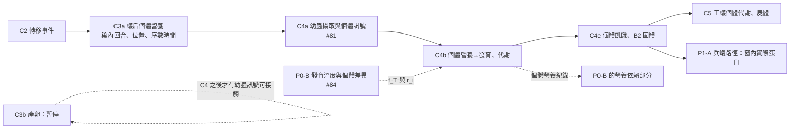

# C4 幼蟲個體營養：科學模型、依賴與驗收設計（Issue #81，2026-11-06）

> **狀態：設計，不改引擎。** 實作時分成三個規則更新 PR（C4a～C4c，§6），每個都有開關、預設關閉、隔離與反例。
> 不推進遊戲日；不改 Day14；不調參；C3b 仍暫停。工程驗收通過不代表科學驗證通過。
> 本文以 `docs/research-design-phase3-lifecycle.md` §4.4.1 為起點，補上它沒有處理的部分：
> - 「遠處幼蟲」的位置模型；
> - 與 C2、C3a、C5、P0-B、#56 的依賴；
> - 工作切分與驗收。

## 1. 要修的缺陷（main `e93933f`，D3／CLAUDE.md §2.1b）

| ID | 位置 | 現在的輸入 | 應該是 |
|---|---|---|---|
| L1（#81，A08-3，ODD G4） | `engine/nutrition.ts:108` `consume` | 每隻幼蟲的求食訊號用**全巢**當日蛋白滿足率 `pFraction` 更新 | 這隻幼蟲自己的攝取與需求 |
| L2（A08-2） | `engine/brood.ts:34` `developBrood` | 幼蟲的生長係數用全巢 `min(pFraction, sFraction)` | 這隻幼蟲自己的營養係數 |
| L3（A08-2） | `engine/brood.ts:36` | 幼蟲的飢餓死亡風險用全巢 `colony.stores.protein_gap_days` | 這隻幼蟲自己的連續缺食日數 |
| L4（F01） | `engine/nutrition.ts:82-83` | 幼蟲的代謝由全巢池一次扣除（`servedLarvae × larva_*_daily`），歸因 `unknown` | 由這隻幼蟲自己攝取的量支付 |

工蟻讀取求食訊號的路徑已經是局部的：`engine/workers.ts:78` `nurseContact` 只把被接觸那隻幼蟲的訊號帶給工蟻。但**訊號本身**來自全巢統計量，所以上游仍是非局部的。

**修改前可重現的失敗**（C4a 的第一個測試，先證明缺陷存在）：
- 在同一天、同一亂數之下，只在**另一個位置**加入 20 隻沒有被接觸的幼蟲。
- 全巢需求上升會使 `pFraction` 下降，所以原本那些幼蟲的 `begging_signal` 全部上升。
- 這隻幼蟲自己被餵的量並沒有改變。

## 2. 科學依據與分類

| 機制 | 依據 | 分類 |
|---|---|---|
| 工蟻把固體蛋白切塊、放在幼蟲頭部附近；蟻后在幼蟲之後才得到標記蛋黃 | R346 Sanders et al. 1992（**本種**，全文） | 文獻支持（機制方向） |
| 缺食延長幼蟲期；恢復餵食後化蛹 | R167 Phillips 1933（**本種**，全文）：25°C 停食 2 週，幼蟲期 32～36 日，恢復餵食 8 日後化蛹 | 文獻支持（方向與一個可比對的觀察）；數值換算為遊戲假設 |
| 每隻幼蟲的飢餓訊號決定它被餵的頻率；每次餵食量大致固定 | R210 Cassill & Tschinkel 1995 | **非本種**（*Solenopsis invicta*）；只作候選機制 |
| 餵食是局部互動；只有工蟻:幼體 < 1 時才降低 | R211 Cassill & Tschinkel 1999 | **非本種**；候選 |
| 幼蟲是消化階級；物質由幼蟲經工蟻流向蟻后 | R347、R348（*Pheidole spadonia*，摘要）、R349 綜述 | **非本種**；B2 路線的候選（C3 設計 §4） |
| 卵→幼蟲 38%、卵被吃 | R136 Chang 1985（本種） | 文獻支持；食卵不在 C4 範圍（E7，另案） |
| 幼蟲每日需求、每口份量、訊號權重、飢餓危險率 | 沒有本種資料 | 遊戲假設，assumption: true；未知值保持 null |

本種沒有幼蟲求食行為（頭部擺動、化學訊號）的研究。訊號的**形式**（一個 0～1 的量）是模型假設，不是已知的本種機制。

## 3. 狀態與區室

每隻幼蟲（`population.brood[]` 中 `stage === 'larva'`）新增：

| 欄位 | 意義 | 遷移（Day14）與新孵化 |
|---|---|---|
| `body.known_balance {sugar, protein}` | 已知收支：自己攝取的 − 自己代謝的 | 新孵化：0（卵階段沒有攝取）；Day14 遷移：0 |
| `body.unknown_initial_reserve` | 遷移時未知的儲備 | Day14 遷移：`null`，永不支出、補值或當成 0（同 C3a 的界線）；新孵化：`'not_applicable'` |
| `location` | 幼蟲所在的巢內位置（C3a 的過渡模型命名了 `store`、`queen`、`brood` 三個位置，但 `engine/queen-feeding.ts` 目前只用到前兩個；C4a 才實際使用 `brood`。P1-B 之後才有真正的巢室） | 預設 `brood` |
| `intake_today {sugar, protein}`、`need_today` | 只供本日營養係數使用；由自己的轉移事件累加 | — |
| `unfed_days` | 自己連續攝取低於門檻的日數 | 0 |
| `begging_signal` | 沿用舊欄位，**只**由自己的缺口更新 | 沿用 |

C2 名冊新增 `larva_body:<id>` 區室（`docs/design-wpc-food-compartments.md` 已預留）。
- **新原因**：
  - `feed_larva`：`crop` → `larva_body`，糖或液態蛋白，交哺；
  - `place_solid_on_larva`：`carried` → `larva_pocket`，B2；
  - `larva_ingest`：`larva_pocket` → `larva_body`；
  - `larva_metabolism`：`larva_body` → `metabolized`；
  - `death_body_to_corpse`。
- B2 依賴 C3a 尚未實作的 `carried`／`larva_pocket`，所以放在 **C4c**（§6），C4a 只做液態路線。

## 4. 模型（候選）

### 4.1 接觸與餵食（C4a）

- 保育工蟻在巢內回合（C3a 的序數時間）走到 `brood`。
  - 從**同一位置**的幼蟲中，以命名亂數串流 `nurse_contact:<worker>` 抽一隻接觸，產生 `larva_contact` 事件。
  - 抽取時依幼蟲 ID 排序（沿用 v21 的作法），所以結果不依陣列順序。
- 接觸時，工蟻依兩個局部量決定要不要餵一口：
  - 這隻幼蟲的 `begging_signal`；
  - 工蟻自己嗉囊的內容。
- 每口的份量固定（候選，R210 非本種；數值遊戲假設）。
- 每筆 `feed_larva` 必須對應同一工蟻、同一幼蟲、同一位置、同一序數時間的 `larva_contact`。
- 同一位置幼蟲變多時，每隻被接觸的機率下降。
  - 這是經由**實際接觸次數**產生的稀釋，不是訊號廣播。
  - 這是候選機制：R211 指出餵食在工蟻:幼體 < 1 時才降低，非本種。
  - 實作後要報告這個效應，不得隱藏。

### 4.2 求食訊號（C4a，修 L1）

```
shortfall_i = clamp(1 − intake_today_i.protein / need_today_i.protein, 0, 1)
begging_i  ← w_prev · begging_i + w_short · shortfall_i      （沿用 larva_begging_previous_weight、larva_begging_shortfall_weight）
```

- 輸入只有這隻幼蟲自己的攝取紀錄與自己的需求，需求只依自己的齡期與巢溫。
- 不讀 `pFraction`、`colony.stores`，也不讀其他幼蟲的數量。
- 糖的缺口是否也進入訊號：本種沒有資料（null）。候選 A 只用蛋白，與舊模型一致；候選 B 取兩者較大。預設 A。

### 4.3 發育（C4b，修 L2）

```
n_i = clamp(intake_today_i / need_today_i, larva_min_nutrition_growth_factor, 1)   （取糖、蛋白兩者的較小值，同舊式）
Δprogress_i = f_T(T_nest) × n_i × r_i / larva_days
```

- `f_T` 目前是 Q10；P0-B（#84）會改成度日或非線性模型。
- `r_i` 是 P0-B 的個體持久發育率因子；C4 之前一律為 1。
- C4 只把營養係數從全巢改成個體，不改溫度模型。

### 4.4 代謝與飢餓（C4b、C4c，修 L3、L4）

- **代謝**：`larva_metabolism` 由自己的 `known_balance` 支付；不足只記為自己的缺口，不向全巢借。
- **飢餓**：
  - 自己的 `unfed_days ≥ larva_mortality_starts_days` 時，用沿用的危險率公式（`larva_daily_hazard_base`、`_slope`、`_cap`）。
  - 輸入改為自己的 `unfed_days`，不再是全巢 `protein_gap_days`。
- **遷移幼蟲**：未知儲備 `null` 不支出，所以已知收支會高估缺口。這是保守界線，不得當成科學結論。
- 死亡時，`larva_body` 的已知收支以 `death_body_to_corpse` 進入屍體區室。
  - C5 之前，屍體區室只是匯，不提供給任何個體。

## 5. 驗收設計

| ID | 內容 | 判準 |
|---|---|---|
| A0 | 修改前證據 | 開關關閉時，§1 的反事實測試使原有幼蟲的訊號全部改變；C4 測試先證明缺陷存在 |
| A1 | 遠處幼蟲反事實（Issue #81 驗收） | 開關打開時，只在**另一個位置**加入沒有被接觸的幼蟲。原有每隻幼蟲的攝取、訊號、發育、存活都逐位元相同。另加一個對照：加在同一位置時，被接觸次數依 §4.1 改變，要報告 |
| A2 | 沒有被餵的這隻幼蟲 | 任兩次執行中，若某隻幼蟲當日攝取為 0、期初狀態相同，則它的訊號、營養係數與 `unfed_days` 相同，與其他幼蟲數、全巢存糧無關（函數式檢查：只用它自己的紀錄重算） |
| A3 | 陣列順序 | 把 `population.workers` 與 `population.brood` 反轉，依 ID 比較每隻幼蟲的結果相同。只涵蓋 C4 新路徑；#56 其他部分是已知違反，照實列出 |
| A4 | 每筆攝取都有來源 | 每筆 `feed_larva` 對應同一工蟻的 `larva_contact`（同位置、同序數）；工蟻嗉囊有足夠的量（容量重播）；C2 每區室閉合 |
| A5 | 不讀全巢統計量 | 靜態檢查：C4 路徑的程式不引用 `stores.protein_gap_days`、`pFraction`、`sFraction`；執行期檢查：用全巢值不同、個體紀錄相同的兩個狀態比較結果 |
| A6 | 獨立讀取器 | `cli/lib/larva-round-replay.ts` 以每隻工蟻與幼蟲的時間軸重驗 A2、A4，並從自己的紀錄重算訊號與營養係數 |
| A7 | 隔離 | 開關關閉時所有輸出與前一版逐位元組相同（golden、rules-isolation） |
| A8 | 多種子、多季節、極端情境 | Day0 A1～A5 × 四季 × 20 種子 × 365 日，以及極端情境。差異全部報告，不作為目標，不挑種子 |
| A9 | 本種觀察算子（科學比對，不是工程驗收） | 模擬 Phillips 1933 的條件：25°C、停食 2 週、恢復餵食。比對幼蟲期延長的**分布**與恢復後到化蛹的日數。數值不吻合時如實記錄，不調參 |

## 6. 工作切分（每一步一個規則更新 PR）

| 步驟 | 內容 | 修的缺陷 | 前置條件 |
|---|---|---|---|
| **C4a** | `larva_body` 區室、`larva_contact`、液態 `feed_larva`、個體求食訊號；發育與死亡仍沿用舊式 | L1（#81） | C2；C3a 的巢內回合（序數時間、位置）；**C3a 開關打開時才能打開 C4a**（共用巢內回合與液態蛋白） |
| **C4b** | 個體營養係數進入發育；幼蟲代謝由自己支付 | L2、L4 | C4a |
| **C4c** | 個體 `unfed_days` 取代全巢缺口天數；B2 固體放置（`carried`、`larva_pocket`） | L3；C3 X13 | C4b；C3a 的路線 A 區室 |

**不放進 C4 的部分**：
- C5：工蟻個體代謝、屍體區室的利用；
- #56 的其他陣列順序依賴：`settleCrops` 依工蟻陣列取用嗉囊等；
- 食卵（E7）；
- 兵蟻路徑（P1-A）；
- 溫度發育模型（P0-B）。

## 7. 依賴關係



- **P0-B 與 C4 的介面**：發育率 = `f_T`（P0-B）× `n_i`（C4）× `r_i`（P0-B）。
  - P0-B 的溫度部分可以先做，不依賴 C4。
  - 「營養造成的發育差異」必須等 C4b 的個體攝取紀錄，不能從文獻的標準差直接換成個體差異。
- **物理**：C4 的接觸和 C3a 一樣是序數時間的過渡接觸，不是物理接觸（物理模組未接入、五項缺陷未修）。
- **C3b**（暫停）：C3 設計中蟻后接觸幼蟲訊號的部分要等 C4。這不是恢復 C3b 的理由。

## 8. 待 Owner 裁示

1. C4a 是否要求 C3a 同時打開，還是讓 C4 有自己的巢內回合。建議前者：避免兩套巢內時間。
2. 糖缺口是否進入求食訊號（§4.2 候選 A／B），預設 A。
3. §4.1 的同位置稀釋效應保留為候選機制，並在結果中報告；或另提替代機制。
4. Day14 遷移幼蟲的已知收支從 0 開始，與 C3a 一致。
