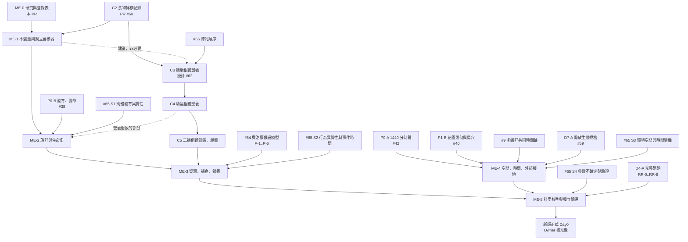

# 數學生態架構（ME-0）：狀態、事件、隨機過程與驗證

> **地位**：研究與架構，**未實作**。不改程式、參數或存檔，不推進遊戲日，不啟動新版正式 Day0。
> - **依據**：Issue #66（數學生態引擎）、Issue #65（多層隨機性，本文件同時是 #65 的 S0 盤點架構）、CLAUDE.md。
> - **對照版本**：main `d701a23`（引擎 v21）。進行中的 PR 會改變部分現況，相關處註明：
>   - #60：C2 食物轉移紀錄與驗證；
>   - #62：C3 蟻后營養設計；
>   - #63：R3-05 逐路段費洛蒙；
>   - #64：費洛蒙候選模型研究；
>   - #59：D4-A／D7-A、ODD。
> - **配套文件**：
>   - `docs/math-ecology-model-registry.md`：現有每一條公式與每一次抽樣的登錄表；
>   - `reports/math-ecology-literature-review.md`：原始文獻與模型契約。
> - **不是新引擎**：ME 工作包都接在既有工作包上（§6），不另建一套平行的模擬核心。

## 1. 原則
1. **公式存在不等於科學正確。** 每條方程都要寫明：
   - 狀態與單位、適用範圍、假設；
   - 來源與證據等級；
   - 可與研究資料比較的觀察指標。
2. **兩個獨立的標籤軸，不可混用。**
   - **陳述類型**（這條式子是哪一種東西）：
     | 類型 | 意義 | 例子 |
     |---|---|---|
     | **I 會計恆等式** | 依定義成立；違反就是程式錯誤 | 人口帳 N(t+Δ)=N(t)+B−D+I−E；區室收支 |
     | **L 一般定律或近似** | 跨物種的物理或生理規律，有已知適用範圍 | 溫度對速率的影響（Q10、Arrhenius 型）；危險率與機率的關係 p=1−exp(−λΔt) |
     | **P 現象模型** | 描述群體層級型態的經典方程 | Logistic、Ricker、Holling、Lotka–Volterra、Levins |
     | **R 機制事件規則** | 個體在某時、某地、因局部條件發生某事件的規則 | 抵達食源、接觸、交哺、獵殺 |
     | **G 遊戲假設** | 為了讓模型能運作而設的數值或結構 | 每日 360 分活動時窗 |
   - **證據等級**（這個機制或數值對本種有多少證據）：A 本種直接；B 他種或一般；C 候選模型；D 純假設。
   - 例：「p=1−exp(−λΔt)」是 L 類（數學上正確），但 λ 的值可能是 D。「Holling 第二型」是 P 類；它在本種的適用性是 C，不是 A。
3. **經典方程是候選，不是規則。**
   - Logistic、Ricker、Holling、Lotka–Volterra、Levins 都只在其假設成立時才適用。在個體導向、事件驅動的引擎中，它們優先作為**宏觀輸出的比較型態**，不作為額外疊加的速率。例如：個體已經逐分鐘遭遇與捕獲，就不得再乘一個 Holling 死亡率。
   - 只有在某個生物群體確實以群組（cohort）而非個體表示、且假設成立時，才可用作群組的事件速率。
4. **收支先於精確度。**
   - 先保證每份食物、每個個體、每筆生物量有來源、去向、持有者、時間與地點。
   - 目前的「份數」（game portions）**不是 mg、不是焦耳**。在沒有實測換算之前，**不得宣稱完成物理質量或能量守恆**。
   - 糖、蛋白、脂質、水、生物量、能量不可互相抵銷。
5. **生態自主。** 植物、半翅目、獵物、外部蟻群與天氣不讀主角蟻群的狀態或需求（CLAUDE.md §2.2）。實際發生的採食、捕食、接觸、競爭可以合法改變環境。
6. **個體因果（D3）。** 個體的攝食、生理、產卵、死亡只依自己實際取得的食物、接觸與自身狀態；全巢總量只作統計與守恆驗證。
7. **合法事件。** 捕食、遷移、出生、死亡都要有合法的來源、時間、位置與 ID；不得「離界＝死亡、入界＝出生」，也不得有無限的外部族群（D7-A）。
8. **不以結果為目標。** 選擇或校準模型時，不以蟻群存活率、成長速度或遊戲平衡為目標（CLAUDE.md §7）；自然滅亡是有效結果。
9. **物種可切換。** 物種差異只在物種參數檔與開關中；程式不判斷物種名稱（CLAUDE.md §4）。換物種時，每個子模型的證據欄位都要重新評估，不得沿用本種數值。

## 2. 狀態空間與尺度
| 層 | 狀態 | 表示 | 時間解析度（現況 → 目標） | 空間解析度（現況 → 目標） |
|---|---|---|---|---|
| 天氣 | 日均溫、日最高溫、降雨、濕度、土壤指數 | 世界單一值 | 每日 → 逐時（P0-A） | 世界單一 → 地點微氣候（P0-A、P1-B） |
| 植物與蜜露、花蜜 | 寄主存活、分泌量、批次 | 每個地點 | 每日 | 地點（圖節點） |
| 半翅目 | 群體大小 | 每個地點一個計數 | 每日 | 地點 |
| 獵物昆蟲 | 存活數、累計死亡、外部池 | 每個地點計數加一個有限外部池 | 每日 | 地點加外部池 → 周圍棲地斑塊（D7-A） |
| 屍體與食源 | 批次（帶來源 ID）、腐敗 | 每個地點的批次清單 | 每日 | 地點 |
| 蟻群食物 | 全巢糖與蛋白帳、工蟻嗉囊 | 遊戲份數 | 每日結算加覓食分鐘（v17+） | 巢一個節點 → 巢室（P1-B） |
| 個體 | 工蟻、幼體、蟻后 | 逐隻個體 | 覓食在事件時鐘上；巢內每日 | 圖節點與路段；巢內沒有空間 |
| 費洛蒙 | 每條邊的強度 | 每個蟻群每條邊一個量 | 沉積在分鐘（v20／v23），衰退每日 | 圖的邊 |

**單位政策**：
- 所有非物理單位標為 `game_portions` 或 `unit: unknown`。
- 要轉成物理單位（例如 mg 乾重、mg 蛋白、J），必須有本種或明示他種的換算量測，並另開規則更新 PR。
- 在那之前，報告只能說「份數收支閉合」，不能說「質量守恆」或「能量守恆」。

## 3. 七個數學框架（M0～M6）與現有引擎的對應
| 框架 | 內容 | 現有引擎 | 既有工作包 |
|---|---|---|---|
| **M0 狀態、事件、單位、登錄表** | 每個子模型的狀態向量、事件或速率、時間與空間解析度、單位、輸入輸出、證據、觀察算子、不變量 | 分散在程式與參數檔；ODD 有部分 | 本 ME-0；ODD（#59） |
| **M1 族群動態與生命史** | 會計恆等式 N(t+Δ)=N+B−D+ΣI−ΣE；個體危險率；發育；群組模型 | 昆蟲：密度制約出生（類 logistic）＋死亡；螞蟻：個體發育與死亡（部分讀全巢帳） | P0-B（#38）、C4、D4-A、#65 S1 |
| **M2 物質、營養與食物網** | 區室收支 Q_end=Q_start+生產+輸入+轉入−消耗−輸出−轉出−損失；化學計量（未來） | C2 份數區室（#60）；生態食源批次 | C2～C5、#62、#65 S2 |
| **M3 捕食、競爭與種間互動** | 個體遭遇與處理時間；Holling 作宏觀比較；共同資源依實際抵達時間競爭 | 逐分鐘遭遇、捕獲、合作搬運；背景競爭者固定分率（未建模的對手） | v9～v20、#9、D7-A |
| **M4 空間生態、多巢、開放邊界** | 圖或斑塊；路段長度與速度；跨區帳；區域族群 | 花園圖、路段長度；有限外部昆蟲池 | P1-B（#40）、D7-A、#9 |
| **M5 時間、數值與隨機過程** | 1440 分事件佇列；具名亂數；危險率事件；群組或 tau-leaping 的評估 | 事件時鐘只在覓食；每日結算；具名亂數串流 | P0-A（#42）、#56、#65 |
| **M6 驗證、可辨識性、不確定性** | ODD、POM、觀察算子、保留資料、敏感度；分開過程隨機、參數不確定、觀察誤差 | Day0 多種子多季節評估；黃金與隔離測試 | ODD、Day0 評估、#65 S4 |

## 4. 隨機性的分層（整合 Issue #65）
**原則**：隨機變數要放進它所屬的數學模型，作為該模型的一部分；不是到處加雜訊。

| 層（#65） | 在數學模型中的位置 | 必須遵守 |
|---|---|---|
| 1 人口隨機（demographic） | M1 個體事件：每個個體在 Δt 內以危險率 λ_i(t) 發生事件，p=1−exp(−λ_iΔt)；群組模型用二項或卜瓦松 | λ 只依該個體的年齡、營養、溫度、傷勢與暴露；變異的尺度隨 N 而變（Lande et al. 2003） |
| 2 持久的個體異質性 | M1／M2：個體建立時抽一次並儲存（例如發育速率乘數、反應門檻） | 不得每天重抽；先依實驗條件把觀察到的變異拆成先天差異、環境差異與量測誤差，不得把全部 SD 歸給先天差異（#65 S1） |
| 3 環境隨機 | 天氣與生態的外生驅動：時間自相關（例如 AR(1)、濕日持續的馬可夫鏈）、空間相關、共同事件 | 一場雨同時影響所有暴露在同一地點的個體；不得每隻螞蟻抽自己的雨；不讀蟻群狀態 |
| 4 行為隨機 | M3／M4：遭遇、路線、招募的選擇 | 只依個體當下可感知的局部狀態；同時事件依世界時鐘處理，不依陣列順序（#56、#9） |
| 5 參數或結構不確定（epistemic） | M6：情境、敏感度、候選模型比較 | **不在每次執行中隨機化參數並冒充自然波動**；用明示的實驗設計掃描 |
| 6 觀察誤差 | M6 觀察算子：虛擬量測 | 不污染權威的世界狀態 |

**具名亂數鍵**（擴充 `engine/rng.ts`，不另建一套）：`world_seed | replicate | day 或 timestamp | region | colony | individual ID | mechanism | event ID`。
- 只有真正需要每日重抽的機制，鍵才包含日期。
- 事件抽樣以穩定的事件身分為鍵，所以陣列重排不改變結果。

## 5. 相依圖

## 6. ME-1～ME-5 分階段 Roadmap
每一步都是獨立的小 PR；改變行為的是規則更新（開關、隔離、黃金、多種子多季節、獨立審查）。

| 階段 | 內容 | 接在哪個既有工作包上 | 進入條件 | 完成條件（工程） | 科學驗收（另列，不與工程混為一談） |
|---|---|---|---|---|---|
| **ME-1 不變量與獨立審核器** | 人口跨區流量帳；食物區室與單位標籤；ID 唯一與生命期；事件時間合法；數值非法（NaN、負值、超出範圍）的執行期檢查 | **擴充 #60 的 C2 驗證器**（引擎檢查加獨立讀取器），不另建第二套 | #60 合併 | 每個不變量都有引擎與讀取器兩份獨立實作；每個都有負面測試，先在修正前重現為「接受」 | 不適用（工程） |
| **ME-2 族群與生命史** | 個體危險率事件；發育的溫度模型候選（度日、非線性）；個體異質性（#65 S1）；昆蟲群組的出生死亡候選（logistic、Ricker、二項）並列 | P0-B（#38）、C4、#65 S1、D4-A | ME-1；P0-B；#65 S1。依賴營養的部分（幼蟲依自己的攝食發育、死亡）另需 C4 | 會計恆等式每日閉合；Δt 收斂測試；陣列順序不變性 | 對照 Yuan 2026 的分布（28°C 非繁殖型 28.73±2.83 d、n=52、24～34 d），比較形狀而不只平均；至少一個昆蟲族群模型對照實測型態 |
| **ME-3 資源、捕食與營養** | 食源生產與耗竭；捕食在個體事件中發生，Holling 曲線作輸出比較；共同資源依實際抵達時間競爭；營養化學計量的區室規劃 | C2～C5、#62、#64（P-1～P-6）、#65 S2、#9 | ME-2 的個體危險率；C5（個體飢餓與屍體區室）；#64；#65 S2 | 每筆捕食、屍體、取用都有來源與時間；不重複計數（沒有額外的 Holling 死亡項） | 由模擬輸出估計的功能反應曲線，與文獻型態比較；費洛蒙依 #64 的觀察算子 O1～O6 |
| **ME-4 空間、時間與外部棲地** | 共用 1440 分事件佇列；地點微氣候；周圍棲地斑塊與跨區帳；多蟻群共用時間軸；區域族群的占據統計（Levins 只作摘要統計） | P0-A（#42）、P1-B（#40）、#9、D7-A（#59 的 `spec-open-ecology`）、#65 S3 | ME-1；P0-A 的時鐘；P1-B 幾何資料；#9；D7-A 規格；#65 S3 | 跨區個體與食物的帳；排程不依陣列；時間解析度改變時的收斂或尺度限制有交代 | 對照臺中 72 h 活動資料（R145）等；斑塊占據的觀察型態 |
| **ME-5 科學校準與獨立驗證** | ODD 與 POM 全面整理；觀察算子對照保留資料；敏感度與不確定性分解；驗證報告供觀察器查詢 | ODD（#59）、Day0 評估、#65 S4、D4-A 的 RR-9 | ME-2～ME-4 | 報告可重現（SHA、種子、輸入、參數、公式版本） | 多型態同時檢核；不可辨識的機制如實報告；不以存活率挑模型 |

**不重複開發**：
- ME-1 是 C2 驗證器的延伸；
- ME-2 的發育與壽命就是 P0-B；
- ME-3 的捕食仍在現有個體事件中；
- ME-4 的時間就是 P0-A 的時鐘，空間就是 P1-B 的幾何。

ME 階段只增加這些工作包缺少的部分：數學契約、單位、不變量、觀察算子與驗證標準。

## 7. 標準

### 7.1 數學正確性
- **因次一致**：每條式子兩邊單位相同；份數與物理單位不混用；比率有明確的時間單位（/日、/分）。
- **定義域**：機率在 [0,1]；危險率 ≥0；計數為非負整數；份數非負。超出定義域時**拋錯**，不得靜默截斷（截斷本身必須是有紀錄的規則）。
  - **過渡規則**：現有引擎有數十個 `clamp`。這條標準適用於**新程式**；現有的每一個 `clamp` 在登錄表中登錄為明示的 G 規則（例如 ECO-HD-STOCK 的容量上限），並在對應的 ME 工作包中決定改為事件，或保留為有紀錄的規則。
- **會計恆等式**（I 類）每日檢查：人口、食物區室、外部池、費洛蒙（強度不是物質，但沉積與衰退要可追溯）。
- **封閉解測試**：每個子模型至少有一個可與解析解比較的情境。例：
  - 固定危險率的存活曲線 S(t)=exp(−λt)；
  - 固定溫度下的度日；
  - 沒有出生的衰減；
  - 二項抽樣的平均與變異數。

- **危險率**（見文獻報告 §4）：
  - 換時間步長時，先由每日機率求 λ=−ln(1−p_日)，再算 p_Δt=1−e^{−λΔt}，不得線性縮放；
  - 多個死因的危險率相加，p=1−exp(−Σλ_iΔt)，死因依 λ_i/Σλ 指定；
  - 基準危險率包含來源資料的條件，不得與同一死因重複疊加。
- **溫度**：每個過程只有一個溫度函數，只套用一次；非線性速率逐時累積，不以日均溫代入（Jensen 不等式）。
- **不重複計數**：個體事件已經產生的過程（捕食、出生、死亡），不得再疊加一個宏觀速率（Holling、logistic）。宏觀方程只作比較型態或摘要統計。

### 7.2 數值穩定性
- **時間步長**：每個以離散步長近似連續過程的子模型，都要做 Δt 減半的收斂測試，或明寫只在某個尺度成立。
- **事件衝突**：同一時刻的事件依明確的種類順序與穩定鍵處理（現有 `KIND_ORDER`）；不依陣列順序。
- **浮點**：食物在檢查時以整數微份（10⁻⁶ 份）比較；捨入不得產生或刪除食物（C2 已有的規則）；捨入規則要寫在登錄表中。
- **小族群極限**：群組或 tau-leaping 近似要與逐事件模擬在小族群下比較，並保證不產生負數。

### 7.3 可重播性
- 同一輸入清單（種子、規則指紋、參數、氣候資料、初始狀態）得到逐位元組相同的輸出（現有黃金測試與 `configHash`）。
- 陣列順序不變性：只改工蟻、幼體、蟻群的儲存順序，依 ID 正規化後的結果不變（#56、#9 的探針要轉為不變量）。
- 每次實驗記錄種子、資料來源、SHA、引擎、參數與公式版本、觀察尺度。

### 7.4 科學驗證
- **ODD**（Grimm et al. 2006、2010、2020）描述每個子模型；**POM**（Grimm et al. 2005）用多個型態同時檢核。
- **觀察算子**：每個子模型要有可與研究比較的量，並對齊研究的觀察條件、單位、樣本數與誤差。
- **分開報告**：
  - 結構驗證（模型是否實作了它宣稱的機制）；
  - 工程守恆；
  - 校準；
  - 用獨立資料的驗證；
  - 敏感度；
  - 預測不確定性。
- **分開三種變異**：過程隨機性（#65）、參數與結構不確定性、觀察誤差。
- **分布而非平均**：報告平均、SD、分位數與分布診斷；保留所有失敗的種子與模型，不只挑最好的。
- **可辨識性**：不同機制可能產生相同型態；無法辨識時如實報告，不選邊。

## 8. 物種切換介面
- 登錄表 §10 的子模型契約有 `taxon` 欄位（逐條公式的表格沒有）；參數一律在 `species/<id>.json`。
- 換物種時，每個子模型的證據等級重新評估；本種的數值不得沿用（CLAUDE.md §4）。
- 只有特定物種才有的機制（例如兵蟻或大工蟻型態、行軍蟻的游牧）用參數開關控制。

## 9. 盤點發現、需要 Owner 注意的事（不是重新詢問已決定的原則）
登錄表 §8 有完整清單，這裡只列需要 Owner 知道的項目。
1. **新發現的 P1 守恆問題**（舊程式，依 CLAUDE.md 不自行修正）：
   - 屍體到期時刪除仍可食用的蛋白（ecology.ts:48）；
   - 蜜露與花蜜超過容量的生產被刪除（ecology.ts:73、83）；
   - 都沒有事件。
   - 建議在 ME-1 先加「世界端食源收支帳」使它們可見，再以規則更新修正（例如改為有事件的腐敗或流失）。
2. **D3 範圍補充**：工蟻飢餓死亡讀全巢 `sugar_gap_days`（queen.ts:22）、工蟻傷勢復原讀全巢 `stress_days`（queen.ts:34）。CLAUDE.md 對 F01／A08 的說明只列蟻后與幼蟲；建議把這兩項列入 C5。
3. **參數凍結進存檔狀態**：昆蟲 K、食源容量、花蜜生產量。規則更新不會影響既有世界，與 CLAUDE.md §6 衝突。要在切換到新版 Day0 時一併處理。
4. **錯標的證據**：
   - R95、R98 被引用為昆蟲族群機制；
   - 一組費洛蒙文獻被引用為嗉囊、交哺、遭遇、捕獲、路段時間等參數的機制依據。
   - 建議另開「證據標籤更正」PR；不改數值，只改標籤。
5. **本種文獻衝突**：Cornelius & Grace 1997（摘要：覓食率不受幼體影響）與 Csata & Dussutour 2019 的引用相反，需要讀全文。

## 10. ODD 與 Roadmap 的同步（ME-0 尚未完成的交付）
- `docs/odd-protocol.md` 與 `docs/roadmap.md` 在 PR #59 中有大幅修改。為避免衝突，本 PR 不改這兩個檔案。
- **這是 ME-0 尚未完成的一項**：Issue #66 要求的 ODD 與 Roadmap 相依，要等 #59 合併後才能交付。
- #59 合併後，另開小 PR：
  - 在 ODD 的設計概念（Stochasticity、Observation）與每個子模型加上登錄表 ID；
  - 在 Roadmap 加入 ME-1～ME-5，並標明它們接在哪些既有工作包上（§6）。

## 11. 本 PR 不做的事
- 不改任何引擎、參數、存檔或日誌。
- 不改 #60、#62、#63、#64 的內容。
- 不選定任何候選模型；選擇要經過 ME-2～ME-5 的實驗與獨立驗證。
